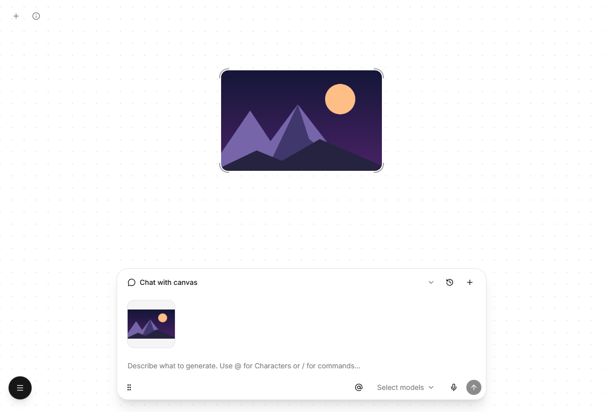
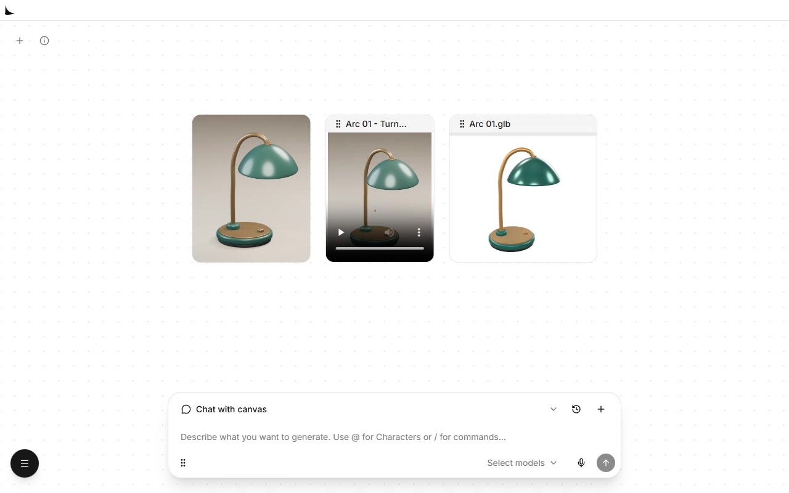
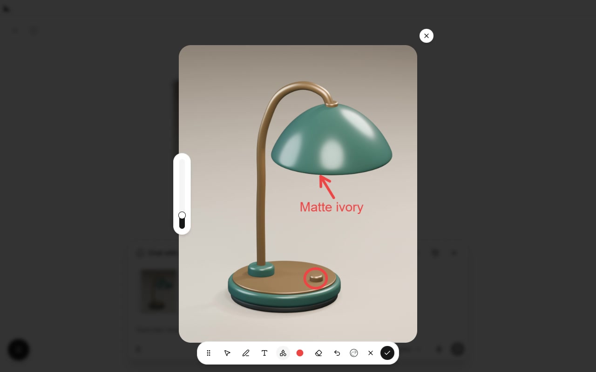
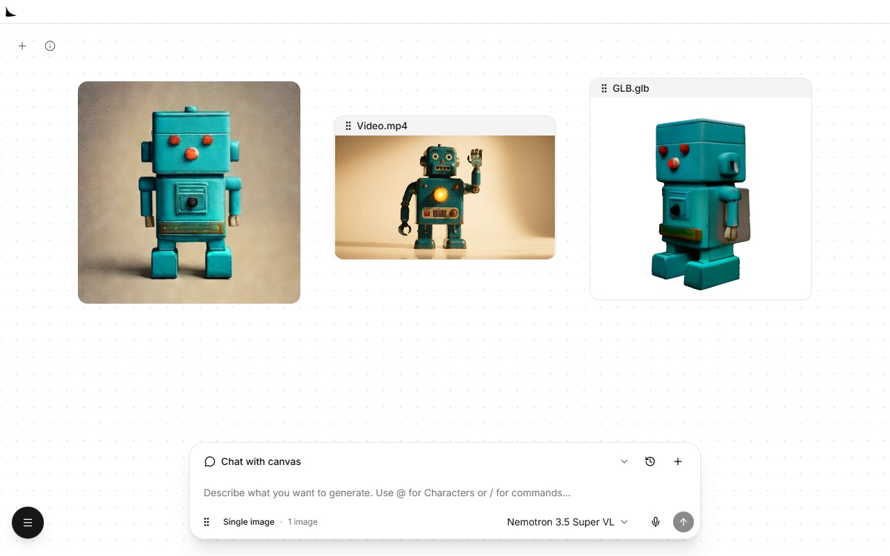
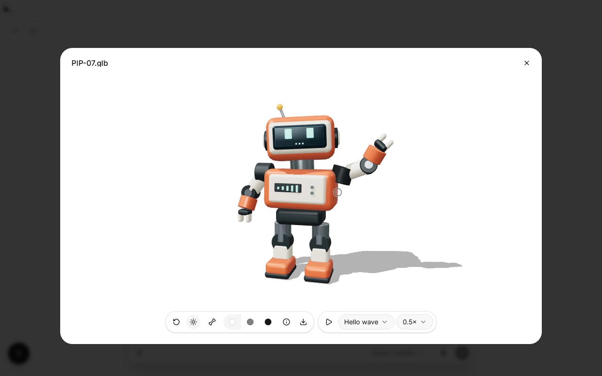
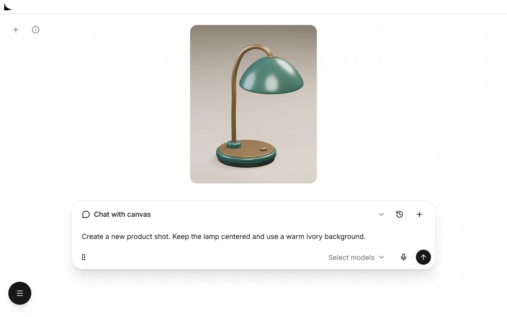
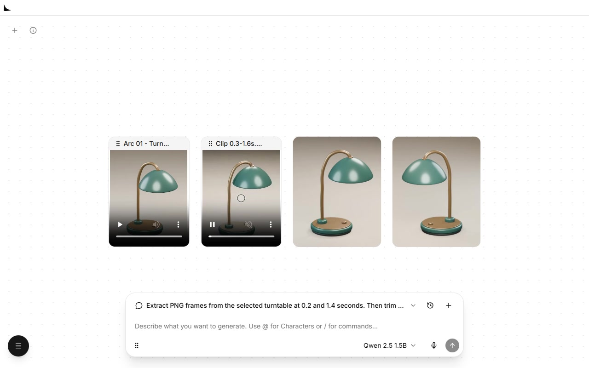
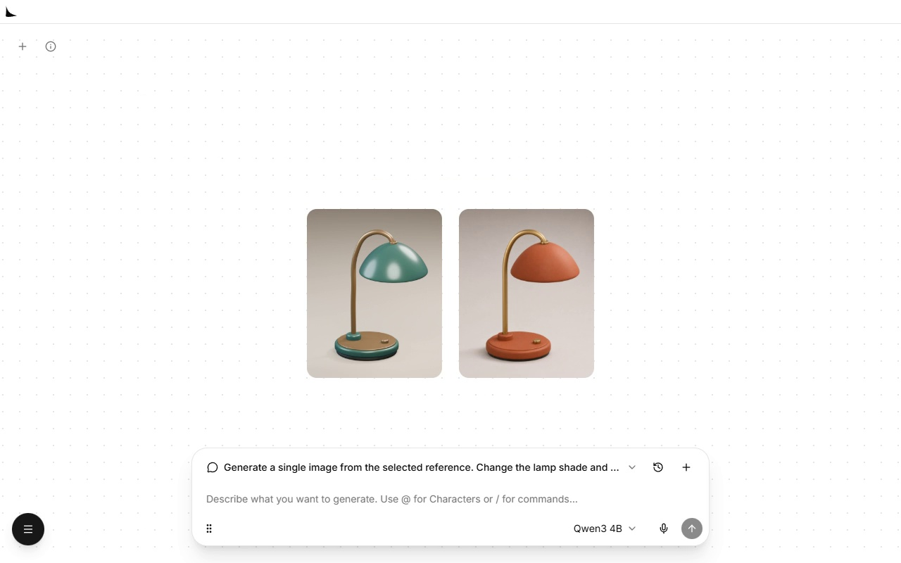

<p align="center">
  
</p>

<h1 align="center">Lomra</h1>

<p align="center">
  <strong>A local-first desktop canvas for images, video, and 3D.</strong><br>
  Arrange references, work with AI models, and bring the results back onto the same canvas.
</p>

<p align="center">
  <a href="#run-from-source"><strong>Run from source</strong></a> ·
  <a href="#what-you-can-do">Features</a> ·
  <a href="#try-it">Try it</a> ·
  <a href="docs/usage.md">Usage guide</a> ·
  <a href="CONTRIBUTING.md">Contribute</a>
</p>

<p align="center">
  
</p>

## What you can do

| Feature | What you can do | Demo |
| --- | --- | --- |
| Organize a canvas | Create a canvas for each project and reopen or rename it in **Canvas history**. Import images, videos, and GLBs, then move, resize, and layer them or use **Reorganize canvas** to arrange them in rows. Select multiple files to use as references in a prompt. | <a href="docs/demos/canvas.webp"><picture><source srcset="docs/demos/canvas.webp" type="image/webp"></picture></a> |
| Edit a picture on the canvas | Choose **Open / Edit** to add arrows, shapes, or text and save a new PNG. Use a compatible image model to erase a brushed area or recompose a picture for a new aspect ratio. **Remove BG** uses Fal.AI. | <a href="docs/demos/picture-editor.webp"><picture><source srcset="docs/demos/picture-editor.webp" type="image/webp"></picture></a> |
| Generate images, clips, and 3D assets | Generate images locally from text with Stable Diffusion or use a hosted image model. Generate video from text with a supported hosted model. Turn one image into a GLB with local Hunyuan3D or TripoSR, or use Fal.AI for text-to-3D, image-to-3D, and supported multiview models. | <a href="docs/demos/generate-media.webp"><picture><source srcset="docs/demos/generate-media.webp" type="image/webp"></picture></a> |
| Preview a 3D model | In **Inspect model**, orbit around a GLB, adjust lighting, show its skeleton, or play animations at different speeds. Save the current view as a PNG at up to 2048 px. | <a href="docs/demos/model-inspector.webp"><picture><source srcset="docs/demos/model-inspector.webp" type="image/webp"></picture></a> |
| Dictate a prompt | Use the mic to record and append a local Whisper transcription to your prompt. | <a href="docs/demos/dictate-prompt.webp"><picture><source srcset="docs/demos/dictate-prompt.webp" type="image/webp"></picture></a> |
| Edit images and video | Crop, split, resize, rotate, or flip images. Extract PNG frames at specific timestamps or trim a clip to WebM. With a Fal.AI key, remove image backgrounds or upscale images 2× or 4×. Edits create new files and keep the originals. | <a href="docs/demos/edit-media.webp"><picture><source srcset="docs/demos/edit-media.webp" type="image/webp"></picture></a> |
| Generate with a signed-in account | On desktop, generate images through a signed-in ChatGPT or Gemini session. Generate video through Gemini if your account has access. | <a href="docs/demos/signed-in-chatgpt.webp"><picture><source srcset="docs/demos/signed-in-chatgpt.webp" type="image/webp"></picture></a> |
| Reuse a character | Choose **Save as Character** on an image to store a named reference with appearance notes. Type `@name` to reuse it in a prompt. |  |
| Inspect and optimize GLBs | Get triangle counts, texture dimensions, and a list of animations in chat. Render front, right, back, and left PNG views, or reduce polygons and texture sizes locally. |  |
| Rig and animate a character | Select a humanoid GLB and ask Lomra to rig it or describe a motion, such as a slow walk with short steps. Meshy rigs the character and Hunyuan Motion generates motion that Lomra applies to a new GLB. Requires a Fal.AI key and credits. |  |
| Turn a story into shots | Start with `/storyboard`, refine the story, and draft a shot list. Edit each shot's description, duration, and cast. Pick an existing image or generate a still for the shot with a configured image model. |  |
| Manage local models | In **Settings → Local models**, download or remove models for chat, image generation, and image-to-3D. Run Ollama on this computer or connect to another machine. Local image-to-3D requires Windows x64 and an NVIDIA GPU with at least 6 GB of VRAM. |  |
| Manage API keys and usage | In **Settings → API keys**, save and test OpenRouter, Fal.AI, and Google AI keys. Check OpenRouter and Fal.AI credit usage or view the Google AI usage Lomra recorded this month. |  |
| Choose which agents to use | In **Settings → Agents**, see which Claude Code, Codex, and OpenCode CLIs are installed and choose which appear in the model picker. View available Codex or Claude Code usage limits and OpenCode session and token counts. |  |

Prompt-driven media tools need a tool-capable chat model. See the
[usage guide](docs/usage.md) for provider setup and media limits.

## Run from source

Install [Bun 1.3.14](https://bun.sh/) and [Node.js 22+](https://nodejs.org/), then run:

```sh
git clone https://github.com/Nxdus/lomra-app.git
cd lomra-app
bun install --cwd apps/frontend --frozen-lockfile
bun install --cwd apps/desktop --frozen-lockfile
bun run --cwd apps/desktop dev
```

The desktop command starts the local Next.js server and opens Lomra in Electron.
See the [usage guide](docs/usage.md#desktop-app-local-first) for packaging commands.

## Try it

1. Drop an image, video, or GLB onto the canvas.
2. To use prompts, choose a chat model. Configure local models or provider keys in **Canvas menu → Settings**.
3. Select a file and describe what you want. Try “Extract frames at 1 and 3 seconds” with a video, or “Inspect this model” with a GLB.

## Your workspace

Lomra saves canvases, chat history, and media in a folder on your machine.
Local inference runs on your machine after setup. Ollama runs on the server
you configure. Hosted providers receive the prompts and attachments needed
for each request, and agent CLIs can access your workspace.
See the [data and provider details](docs/usage.md#data-and-providers).

## Contributing

See [CONTRIBUTING.md](CONTRIBUTING.md) for checks and pull requests.
Report vulnerabilities privately using [SECURITY.md](SECURITY.md).

## License

[Apache-2.0](LICENSE) · [NOTICE](NOTICE) · [Third-party models and assets](docs/usage.md#third-party-models-and-assets)
